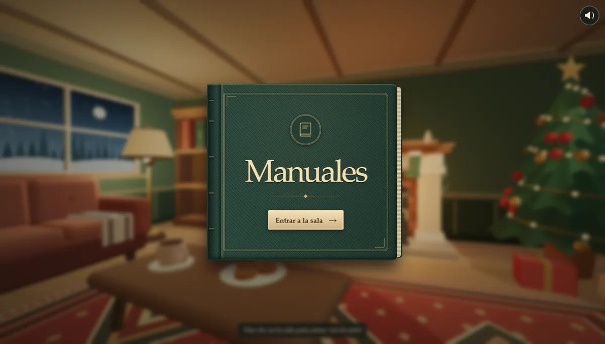
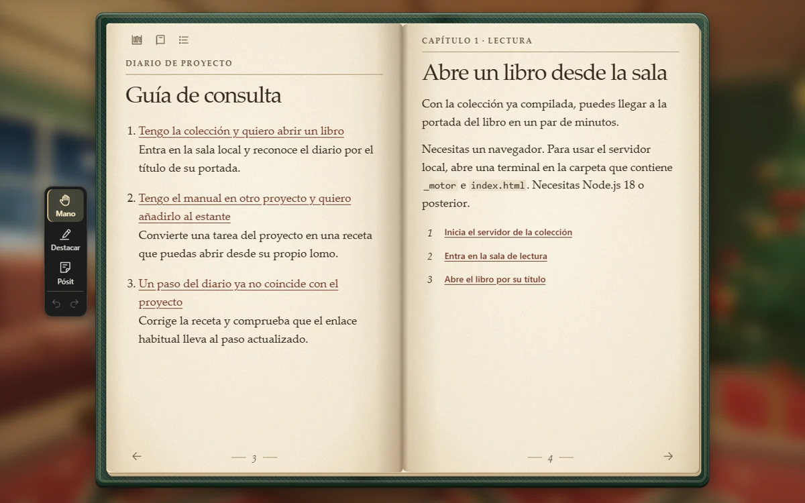

# Diarios de proyectos

Una biblioteca local de manuales interactivos. Entra en una sala 3D, elige un libro y encuentra la receta que corresponde a tu situación. La skill aporta la interfaz y las primitivas para que el agente se concentre en escribir pasos, diagramas y páginas de consulta.



## La colección, explicada como diario

<a href="./docs/ejemplo.html"></a>

El ejemplo explica cómo abrir la sala, crear un diario desde otro proyecto y actualizarlo. Abre el [ejemplo HTML](./docs/ejemplo.html) en el navegador desde la carpeta del repositorio. En la colección original, su definición editable está en `diarios/diario-de-proyecto/diario.mjs`.

## Abrir la colección

Con Node.js 18 o posterior, ejecuta desde la raíz:

```sh
node _motor/construir.mjs
node _motor/servir.mjs
```

Abre [Manuales en localhost](http://127.0.0.1:4317/manuales/). El servidor guarda las anotaciones y preferencias en `.manuales/estado.json`.

## Escribir un diario

1. Crea un proyecto con `node .agents/skills/diario-de-proyecto/scripts/nuevo.mjs . mi-proyecto`.
2. Edita `diarios/mi-proyecto/diario.mjs`. Empieza por las situaciones del lector y enlaza cada una a la receta correspondiente. Incluye resultados esperados cuando guíen la acción siguiente y reserva las viñetas finales para recetas que convenga poder retomar.
3. Ejecuta `node _motor/construir.mjs mi-proyecto` y abre el diario desde la sala.

Consulta las [reglas editoriales y las primitivas](./_motor/REGLAS-DEL-DIARIO.md) y el [diario de ejemplo](./_motor/plantilla/diario.mjs).

### Crear un diario desde otro proyecto

La carpeta abierta en el agente es el **proyecto fuente**. La **colección de destino** es la que contiene `_motor/` y `diarios/`. El agente lee la fuente y crea el diario en la colección.

### Instalar la skill en un comando

Pega el bloque completo en PowerShell. Requiere Git, Node.js 18 o posterior y una cuenta con acceso al repositorio privado. Instala la skill con el generador, el lector y sus recursos para ambos agentes.

```powershell
& {
  $temporal = [IO.Path]::GetFullPath([IO.Path]::GetTempPath())
  $copiaDiarios = Join-Path $temporal ("diarios-skill-" + [guid]::NewGuid())
  try {
    git clone --depth 1 https://github.com/ClaudioH19/diarios-de-proyectos.git $copiaDiarios
    if ($LASTEXITCODE -ne 0) { throw 'No se pudo clonar el repositorio de la skill.' }
    node (Join-Path $copiaDiarios '.agents/skills/diario-de-proyecto/scripts/instalar.mjs')
    if ($LASTEXITCODE -ne 0) { throw 'No se pudo instalar la skill.' }
  } finally {
    if ((Split-Path -Parent $copiaDiarios) -eq $temporal.TrimEnd([IO.Path]::DirectorySeparatorChar) -and (Test-Path -LiteralPath $copiaDiarios)) {
      Remove-Item -LiteralPath $copiaDiarios -Recurse -Force
    }
  }
}
```

Repite el comando para actualizar. Si ya tienes el repositorio clonado, ejecuta `node .agents/skills/diario-de-proyecto/scripts/instalar.mjs` desde su raíz. Si recibiste el ZIP, descomprímelo y ejecuta `node scripts/instalar.mjs` desde la carpeta `diario-de-proyecto`. Añade `--agente=codex` o `--agente=claude` al comando de Node para instalar solo en ese agente.

| Agente | Carpeta personal | Invocación |
| --- | --- | --- |
| Codex | `~/.agents/skills/diario-de-proyecto/` | `$diario-de-proyecto` |
| Claude Code | `~/.claude/skills/diario-de-proyecto/` | `/diario-de-proyecto` |

Abre una sesión en el otro proyecto, invoca la skill y pide algo así:

> Usa este proyecto como fuente. Crea el diario `mi-proyecto` en la colección `C:/ruta/Diarios de proyectos`. Documenta los procedimientos como recetas por situación y verifica el diario generado.

Si el agente tiene un espacio de escritura restringido, añade la colección como carpeta de trabajo autorizada. También puedes llamar al script directamente desde el otro proyecto:

```powershell
$coleccion = 'C:/ruta/Diarios de proyectos'
node "$coleccion/.agents/skills/diario-de-proyecto/scripts/nuevo.mjs" "$coleccion" mi-proyecto
# Escribe el contenido en diarios/mi-proyecto/diario.mjs dentro de la colección.
node "$coleccion/_motor/construir.mjs" mi-proyecto
```

[Ubicaciones de skills en Codex](https://developers.openai.com/codex/skills) · [Ubicaciones de skills en Claude Code](https://code.claude.com/docs/en/skills)

## Estructura

| Carpeta | Contenido |
| --- | --- |
| `diarios/<slug>/` | Definición editable, imágenes locales y diario HTML generado |
| `_motor/` | Primitivas, reglas, generador y servidor |
| `assets/` | Lector y sala interactiva |
| `notas/` | Notas Markdown de trabajo para Obsidian |
| `.agents/skills/diario-de-proyecto/` | Skill y recursos para iniciar otras colecciones |

## Conectar herramientas

- **Obsidian.** Abre la raíz como bóveda y empieza por [el índice de notas](./notas/Indice.md). Puedes usar notas Markdown como fuente al preparar una receta. [Administrar bóvedas](https://obsidian.md/help/manage-vaults)
- **Codex y Claude Code.** Abre el proyecto desde su raíz. [AGENTS.md](./AGENTS.md) enlaza a las reglas y a la skill. [CLAUDE.md](./CLAUDE.md) importa ese mismo archivo. En Codex puedes pedir «Usa `$diario-de-proyecto` para documentar qué hacer cuando falla una actualización». [Codex](https://developers.openai.com/codex/guides/agents-md) · [Claude Code](https://code.claude.com/docs/en/memory)
- **Graphify.** Instala `graphifyy` con `uv tool install graphifyy` y ejecuta `graphify extract . --code-only` desde la raíz para mapear el código localmente. Lleva ese mapa a la bóveda con `graphify export obsidian --dir notas/graphify`. Para invocarlo desde el asistente, usa `graphify codex install --project` o `graphify claude install --project`. [.graphifyignore](./.graphifyignore) delimita el material que se analiza. La extracción semántica de documentos usa el modelo que configures. [Graphify](https://github.com/Graphify-Labs/graphify)

Para compartir la skill, genera su ZIP con `python _motor/empaquetar.py`.
